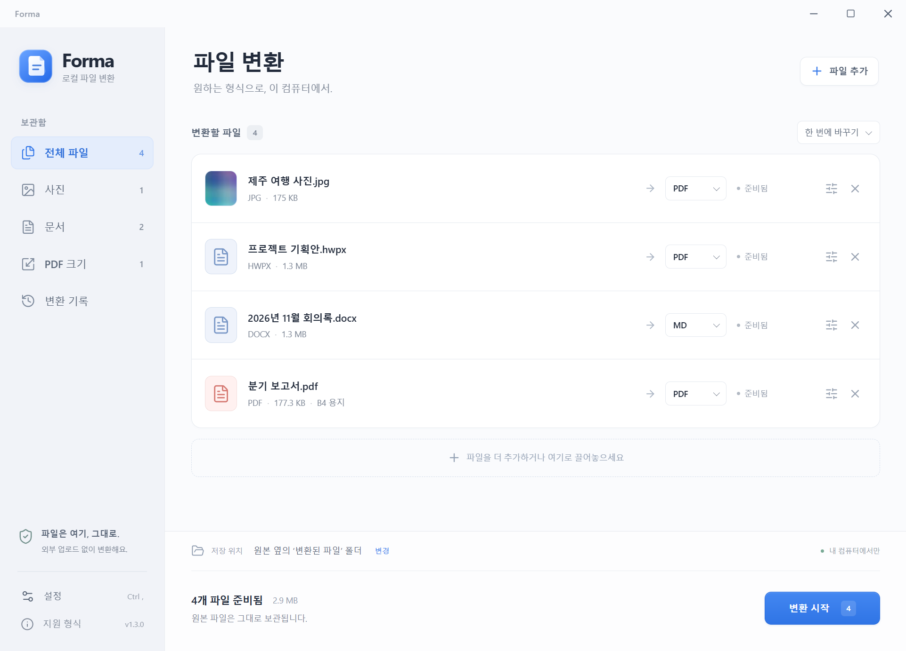
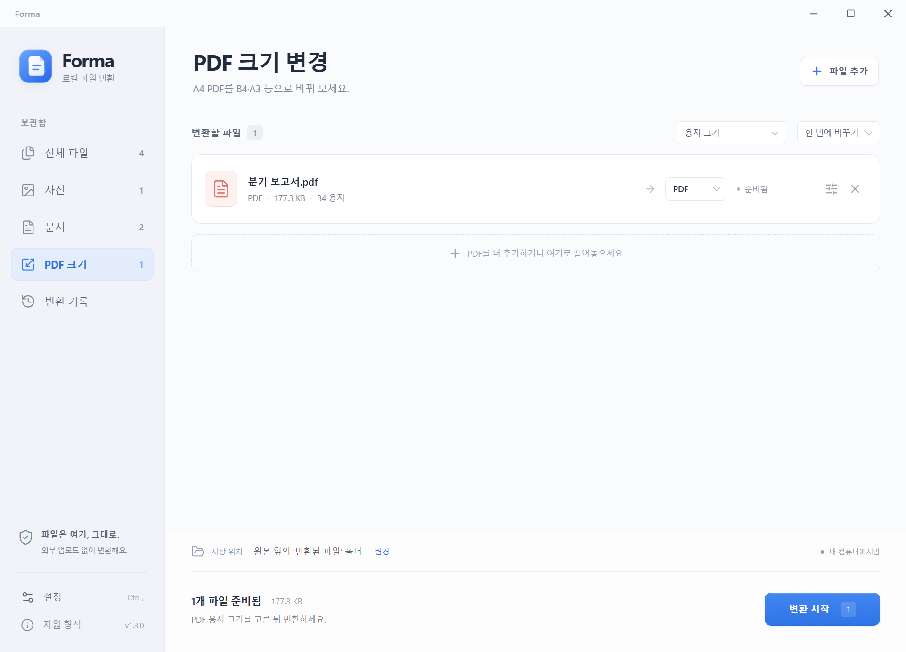
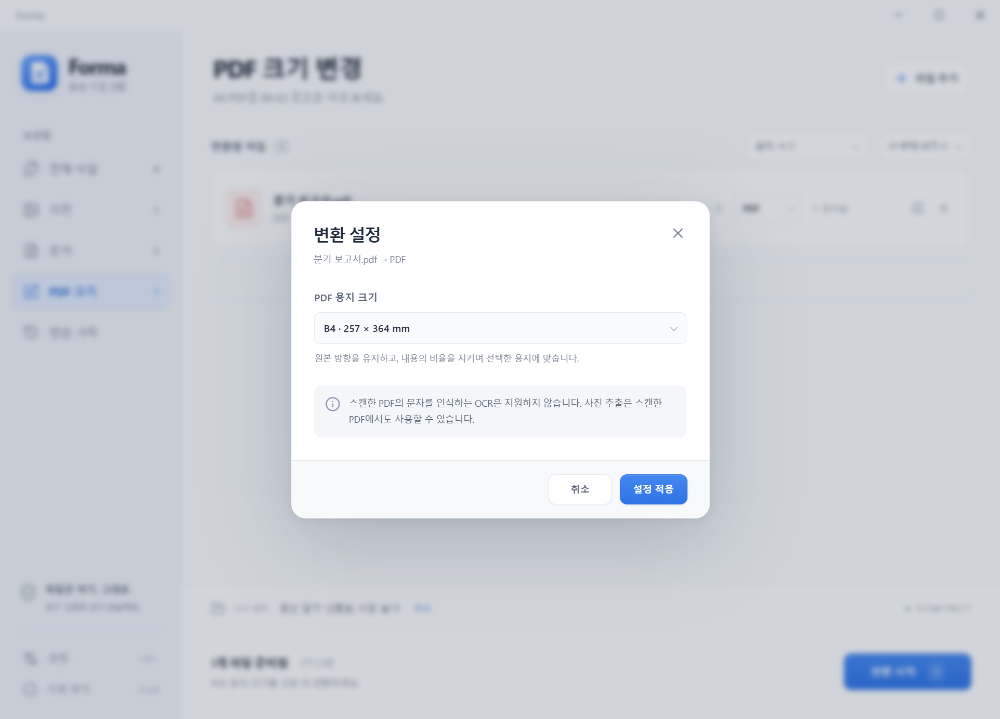

# Forma

사진과 문서를 이 컴퓨터에서 변환하는 Windows 앱입니다.
파일을 외부 변환 서버에 올리지 않습니다. 계정과 API 키가 필요하지 않습니다.

> A local Windows file converter for photos, documents, HWP/HWPX, Office, PDF and Markdown.



## 시작하기

- 설치: [GitHub Releases](https://github.com/SbEnChOi/forma-converter/releases/latest)에서 `Forma-1.3.0-Setup.exe`를 받아 실행합니다. 설치 과정에서 바탕 화면 바로가기를 만들 수 있습니다.
- 직접 빌드: 아래 **개발과 검사**의 `npm run package`를 실행하면 `release/Forma-1.3.0-Setup.exe`와 `release/win-unpacked/Forma.exe`가 만들어집니다.
- Windows 10/11, 64비트 환경을 지원합니다.
- 사진, PDF 사진·텍스트 추출, 한글 문서 변환은 앱에 포함된 도구로 작동합니다.
- DOC·DOCX·RTF·ODT·TXT의 Office 변환과 PDF→DOCX는 설치된 Microsoft Word를 사용합니다. DOCX·TXT→MD와 DOCX→HWPX, HWP·HWPX·PDF→MD는 Word 없이도 작동합니다.
- 엑셀 문서는 Microsoft Excel, 프레젠테이션 문서는 Microsoft PowerPoint가 필요합니다. 앱이 설치 여부를 확인해 가능한 출력만 표시합니다.

## 사용법

1. 파일을 끌어놓거나 **파일 추가**를 누릅니다. 여러 파일을 함께 추가할 수 있습니다.
2. 각 파일 오른쪽에서 출력 형식을 고릅니다. **한 번에 바꾸기**로 같은 형식을 일괄 적용할 수도 있습니다.
3. 파일 오른쪽의 설정 버튼에서 사진 품질·크기·배경색, PDF 페이지 범위 또는 **PDF 용지 크기(A3·A4·B4 등)**를 바꿉니다.
4. 아래의 **저장 위치**를 확인하고 **변환 시작**을 누릅니다.
5. 완료한 파일의 **열기** 또는 폴더 아이콘으로 결과를 확인합니다.

기본 저장 위치는 각 원본 옆의 `변환된 파일` 폴더입니다.
원본과 기존 결과를 덮어쓰지 않습니다. 같은 이름이 있으면 `(2)`, `(3)`을 붙입니다.
여러 페이지를 사진으로 내보내면 결과를 별도 폴더에 저장합니다.

사진 두 장 이상을 PDF로 고르면 **사진을 PDF 하나로 합치기** 옵션이 나타납니다.
목록 순서대로 사진 한 장을 PDF 한 페이지에 배치합니다.

**Ctrl+O**로 파일을 추가하고, **Ctrl+Enter**로 변환을 시작하며, **Ctrl+,**로 설정을 엽니다.
변환 기록은 이 컴퓨터에만 보관합니다. 기록을 지워도 실제 원본과 결과는 지워지지 않습니다.

## PDF 크기 변경



A4 PDF를 B4·A3 등으로 바꿀 때는 사이드바의 **PDF 크기** 탭을 사용합니다.

1. **PDF 크기** 탭에서 PDF를 추가합니다. 출력 형식은 자동으로 `PDF`가 됩니다.
2. 목록 위의 **용지 크기**에서 `A4`, `A3`, `B4`, `B5`, `A5`, `Letter`, `Legal` 중 하나를 고릅니다. 파일별 설정에서도 바꿀 수 있습니다.
3. **변환 시작**을 누릅니다.

파일별 설정에서는 아래처럼 용지 크기를 지정합니다.



원본 PDF는 수정하지 않고 새 PDF를 만듭니다. 페이지 수와 방향을 유지하며 내용의 비율을 지켜 선택한 용지에 맞춥니다.
이 과정에서 PDF 링크·주석은 결과에서 빠질 수 있고, 스캔 PDF의 OCR은 지원하지 않습니다.

## 지원 형식

| 입력 | 출력 |
| --- | --- |
| JPG/JPEG, PNG, WEBP, AVIF, TIFF, BMP, GIF, SVG, HEIC/HEIF | JPG, PNG, WEBP, AVIF, TIFF, PDF |
| HWP 5.x | PDF, DOCX, HWPX, TXT, MD |
| HWPX | PDF, DOCX, TXT, MD |
| DOC, RTF, ODT, TXT | PDF, DOCX, TXT, HTML, MD — 원본과 같은 출력 제외 |
| DOCX | PDF, HWPX, TXT, HTML, MD |
| XLS, XLSX, CSV | PDF, XLSX, CSV — 원본과 같은 출력 제외 |
| PPT, PPTX | PDF, PPTX, 페이지별 PNG/JPG — 원본과 같은 출력 제외 |
| PDF | PDF(용지 크기 변경), 페이지별 PNG/JPG, TXT, DOCX, MD |

암호가 걸린 문서와 배포용 제한 파일은 지원하지 않습니다.
스캔한 PDF의 문자 인식(OCR)은 포함하지 않습니다. 스캔 PDF도 사진으로 추출할 수 있습니다.
움직이는 GIF와 여러 페이지 TIFF·HEIC는 첫 번째 이미지를 변환합니다.
사진의 방향 정보를 반영하고, 크기 변경은 비율을 유지하며 원본보다 확대하지 않습니다.

한글과 Word의 글꼴·쪽 나눔은 다를 수 있습니다. 복잡한 표·도형·수식은 결과를 열어 확인해 주세요.
DOCX→HWPX는 문단·표·그림을 기준으로 변환하며, 세부 서식과 복잡한 배치는 달라질 수 있습니다.
구형 바이너리 HWP로 새로 저장하는 기능은 포함하지 않습니다. 한글용 출력은 HWPX를 사용합니다.
PDF→DOCX의 편집 가능 여부와 배치는 원본 PDF의 구조에 따라 달라집니다.
MD는 제목·굵게/기울임·목록·링크·표를 Markdown 문법으로 옮깁니다. 그림은 `.md` 옆에 `image-1.png`처럼 저장하고 본문에서 연결합니다. PDF→MD는 제목·목록 구조 정보가 없어 글자만 옮기며, 스캔 PDF의 OCR은 지원하지 않습니다.
PDF로 저장할 때 A3·A4·A5·B4·B5·Letter·Legal 중에서 용지를 고를 수 있습니다. 원본 페이지 방향을 유지하고 내용의 비율을 지킨 채 선택한 용지에 맞추며, 이 과정에서 PDF 링크·주석은 결과에서 빠질 수 있습니다.
PDF→PDF는 페이지 수와 검색 가능한 글자를 유지하면서 용지만 바꿉니다. 원본 파일은 변경되지 않습니다.

한 번에 500개까지 파일을 추가할 수 있습니다. 사진 입력은 파일당 512MB, 문서는 256MB까지 처리합니다.
Office 작업이 2분 안에 끝나지 않으면 해당 파일만 중단하고 원인을 안내합니다.

## 개발과 검사

Node.js 22.13 이상이 필요합니다. 아래 작업은 `forma-converter` 폴더에서 실행합니다.

```powershell
npm ci
npx install-electron --no
npm run dev
```

```powershell
npm test
npm run typecheck
npm run build
npm run test:app
node scripts/check-office.mjs
npm run package
```

`test:app`은 별도의 시험 프로필에서 실제 Windows 앱을 열어 검사합니다.
Office 검사는 원본 사본을 사용하며, 앱이 연 문서와 자신이 만든 Office 인스턴스만 정리합니다.
시험 결과와 화면은 `output`에 저장합니다. 배포 앱에는 시험용 데이터가 포함되지 않습니다.

HWP·HWPX에는 `@rhwp/core`와 vendored HanDoc 코드를 사용합니다.
HanDoc에는 이미지 참조와 색상 해석을 보완한 작은 수정이 있습니다. 원본 버전은 `vendor/handoc/UPSTREAM_COMMIT`에 기록했습니다.
Apple 스타일 화면은 설치한 `emilkowalski/skills`의 `apple-design`과 `emil-design-eng` 지침을 반영했습니다.

## 오픈소스

이 앱의 코드는 MIT 라이선스입니다. 포함된 구성 요소의 라이선스와 고지는 `THIRD_PARTY_NOTICES.md`에 있습니다.
Electron과 Chromium의 고지는 실행 폴더의 라이선스 파일에서도 확인할 수 있습니다.
이 앱은 Apple, Convertio 또는 한글과컴퓨터가 만든 공식 제품이 아닙니다.
